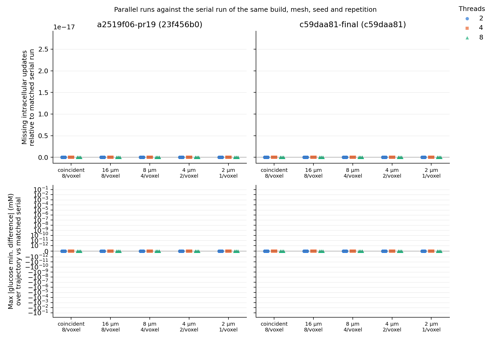
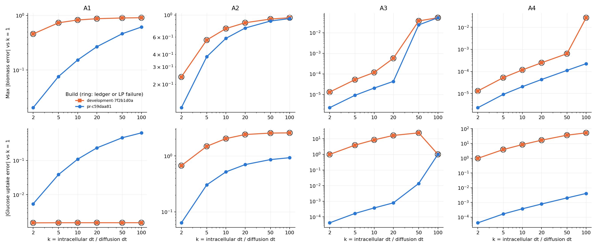
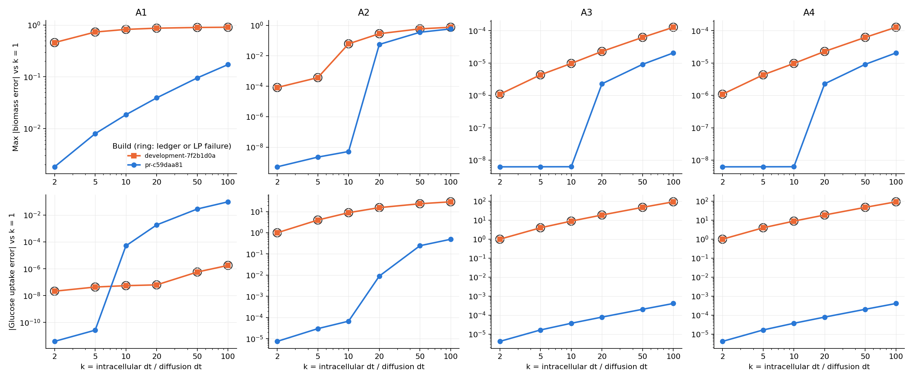
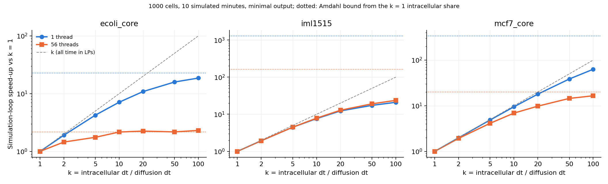
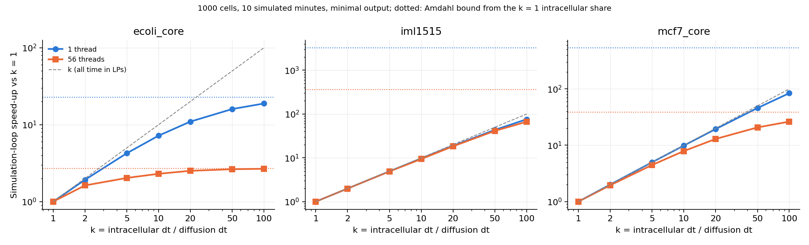
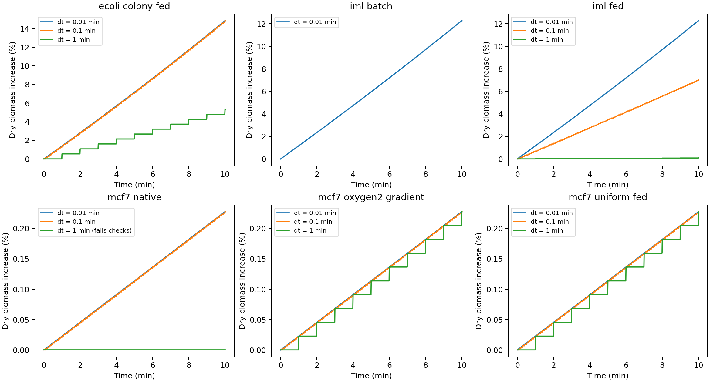
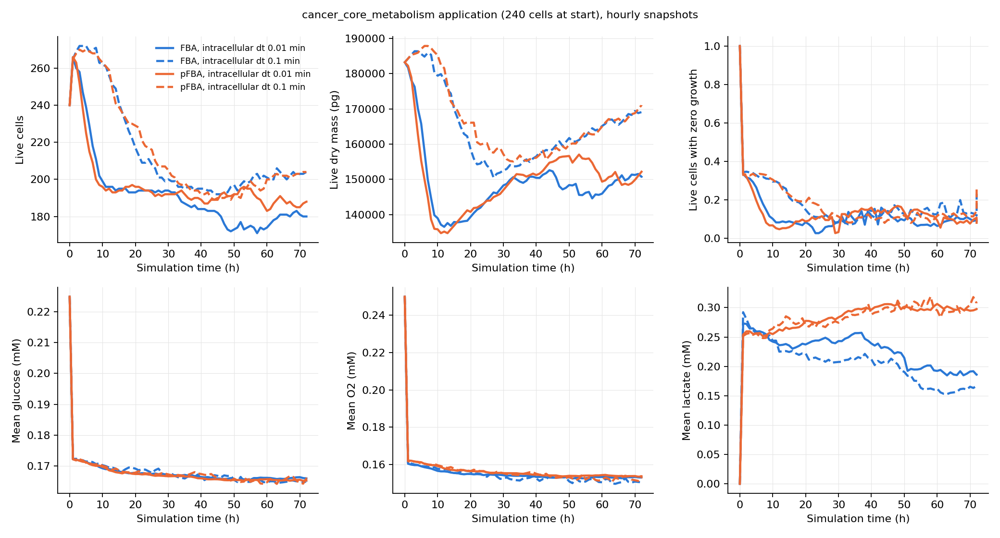
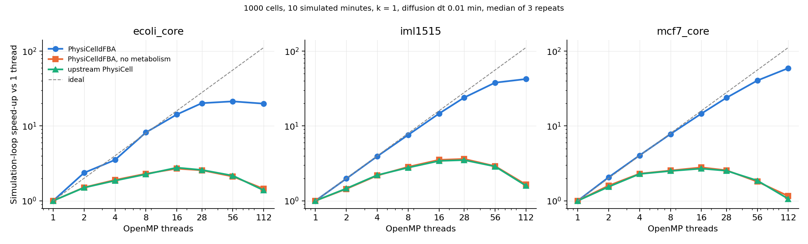

# Final benchmark results

Every study run on a single PhysiCelldFBA version, without patches:
**PR `fix/intracellular-dt-exchange`, commit `c59daa81`**, which is `development` @
`7f2b1d0a` plus the one-line exchange fix and its regression test. The timestep accuracy
study also runs the unfixed `7f2b1d0a` to document the defect. Runs of 2026-11-02 (sections
1–4): 91 Slurm jobs, 691 simulations. Runs of 2026-11-04 (sections 5–6): 140 jobs, 413
simulations. All completed. Each study folder below has its own tables, figures and compact
per-run evidence.

> **Version:** the PR merge is postponed until the PhysiCelldFBA release, and `development` is
> frozen until then. `c59daa81` is therefore the benchmarked version. After the merge, compare the
> merged tree with `c59daa81` and record the result in [PROVENANCE.md](../../../PROVENANCE.md).
> Results stay valid as long as the engine and the templates used are unchanged.

| Study | Report | Runs | Outcome |
|---|---|---:|---|
| Shared voxel (race fixes, PR #19) | [voxel-final-20261102](../voxel_sharing/voxel-final-20261102/README.md) | 60 | Parallel identical to serial |
| Mesh occupancy | [mesh-final-20261102](../voxel_sharing/mesh-final-20261102/README.md) | 240 | Parallel identical to serial at every occupancy |
| Consistency with 2026-10-27 | [final-vs-20261027](../voxel_sharing/final-vs-20261027/README.md) | 600 | 75/75 serial runs identical across versions |
| Timestep accuracy, dt 0.01 min | [tradeoff-accuracy-d0_01](../timestep/tradeoff-accuracy-d0_01-final-20261102/README.md) | 58 | See below |
| Timestep accuracy, dt 0.001 min | [tradeoff-accuracy-d0_001](../timestep/tradeoff-accuracy-d0_001-final-20261102/README.md) | 58 | See below |
| Timestep cost, dt 0.01 min | [tradeoff-cost-d0_01](../timestep/tradeoff-cost-d0_01-final-20261102/README.md) | 126 | See below |
| Timestep cost, dt 0.001 min | [tradeoff-cost-d0_001](../timestep/tradeoff-cost-d0_001-final-20261102/README.md) | 126 | See below |
| Growth conditions | [growth-final-20261102](../growth_conditions/growth-final-20261102/README.md) | 23 | 22 pass all checks (10 before the fix) |
| Cancer FBA vs pFBA | [pfba-final-20261104](../pfba/pfba-final-20261104/README.md) | 8 | Same growth, 192× less internal flux, 1.3–2× cost |
| Performance and scaling | [scaling-final-20261104](../performance/scaling-final-20261104/README.md) | 405 | No add-on overhead; LPs scale to 38–41× on 56 threads |

Builds (GCC 11.5.0, `-O3 -march=native -fopenmp -DPHYSICELL_BENCHMARK`, Sapphire Rapids;
records in [builds/](builds/)):

| Build | Source | Exchange constants built for | Unit-test binary | Cancer binary |
|---|---|---|---|---|
| fix | `c59daa81` | `diffusion_dt` | `689e43c1e7cc…` | `15439660433d…` |
| dev | `7f2b1d0a` | `dfba_time_step` | `f2ba963fe684…` | `13b7c5aaafb1…` |
| upstream | PhysiCell `49d7cc54`, template project, core hooks only | — | `2e62bcfd885e…` (single binary) | |

## 1. Race conditions (PR #19): parallel results equal serial

- All **225 parallel runs** (2/4/8 threads; coincident cells and 16/8/4/2 µm meshes) are
  bitwise-identical to their matched serial run: same updates, same glucose trajectory, same
  per-cell dry mass. There are no missed updates and no exchange-balance failures.
- All **75 serial runs** are identical to the 2026-10-27 runs (PhysiCelldFBA `a2519f06`). Neither
  the exchange fix nor the reorganised configurations change anything at equal timesteps.
- The only flag is the known serial undershoot (−3.78×10⁻⁶ mM coincident, −1.19×10⁻⁶ mM on
  the 2 µm mesh). It comes from the uptake cap using pre-growth dry mass
  ([explanation](../voxel_sharing/before-after-20261027/README.md#remaining-serial-undershoot)).

Identity here partly reflects the identical benchmark cells. With heterogeneous cells, sums
are order-dependent at rounding level (~10⁻¹⁵), as the PR #19 update-order test shows.

## 2. Timestep accuracy (Part A): what running the metabolism less often costs in accuracy

Scenarios: **A1** E. coli core, 1 cell, closed 10 mM glucose, 2 µm voxels; **A2** E. coli core,
16 cells, fed medium, 2 µm; **A3** MCF7 core, 1 cell, 15 µm; **A4** MCF7 core, 16 cells, fed,
15 µm. 240 simulated minutes, serial, fixed positions and population, biomass growth on.
k = intracellular dt / diffusion dt. Errors are relative to k = 1 of the same build.

| Diffusion dt 0.01 min | Diffusion dt 0.001 min |
|---|---|
|  |  |

**Biomass error with the fix**: final value, with the maximum over the trajectory in brackets where it differs. For A3/A4 the larger of the two scenarios' trajectory maxima is shown.

| k | A1, dt 0.01 | A2, dt 0.01 | A3/A4, dt 0.01 | A1, dt 0.001 | A2, dt 0.001 | A3/A4, dt 0.001 |
|---:|---:|---:|---:|---:|---:|---:|
| 2 | −0.50% (2.0%) | −11.6% | 2.3×10⁻⁶ | −5×10⁻⁶ (0.18%) | 5×10⁻¹⁰ | 6.2×10⁻⁹ |
| 5 | −3.6% (7.6%) | −37.9% | 9.1×10⁻⁶ | −2×10⁻⁵ (0.80%) | 2×10⁻⁹ | 6.2×10⁻⁹ |
| 10 | −10.0% (15.3%) | −58.1% | 2.1×10⁻⁵ | −1×10⁻⁴ (1.9%) | 5×10⁻⁹ | 6.3×10⁻⁹ |
| 20 | −21.4% (26.8%) | −73.9% | 4.3×10⁻⁵ | −0.18% (3.9%) | −5.5% | 2.3×10⁻⁶ |
| 50 | −42.3% (46.3%) | −87.0% | A3 −2.4%; A4 1.1×10⁻⁴ | −2.6% (9.5%) | −35.0% | 9.1×10⁻⁶ |
| 100 | −58.7% (61.4%) | −92.1% | A3 infeasible; A4 2.3×10⁻⁴ | −9.0% (17.3%) | −57.8% | 2.1×10⁻⁵ |

- **Every run of the fixed build passes the exchange balance.** The only LP failures are A3 at
  k = 100 and dt 0.01, where the cap limits oxygen to the voxel's content over a 1-min window.
- **The window length, not k, governs the error.** A3 at k = 100 is infeasible with dt 0.01
  (1-min window) and accurate to 2×10⁻⁵ with dt 0.001 (0.1-min window). The error begins
  when one window's uptake demand exceeds what the cell's voxel holds,
  D = Vmax·m_cell·Δt_intracellular / (c·V_voxel) ≈ 1
  ([derivation and onset data](../timestep/tradeoff-accuracy-20261027/README.md#what-sets-the-error-window-demand-versus-voxel-content)).
  Cancer cells in 15 µm voxels stay below it up to 0.1-min windows. E. coli in 2 µm voxels
  crosses it as the cells grow.
- In A1 the trajectory error exceeds the final error. A longer window delays uptake, but in
  a closed pool the cell eventually takes the same glucose.
- Population is fixed: cells grow 12–28× without dividing, which raises D over time. The late
  E. coli errors are therefore upper bounds for these geometries.
- **Reference check:** halving the diffusion dt at k = 1 (A3) changes final biomass by 5×10⁻⁶
  (dt 0.01) and 5×10⁻⁷ (dt 0.001), and glucose uptake by 0.33% and 0.033%.

**Unfixed build (`7f2b1d0a`), for comparison:**
- At dt 0.01, 23 of 24 runs with k > 1 fail the exchange balance (all except A3 at k = 100,
  where every LP is infeasible and nothing is exchanged). At dt 0.001, 24 of 24 fail.
- 12 and 10 runs (dt 0.01 / 0.001) have negative concentrations, and 9 and 3 have LP failures.
- Glucose uptake reaches 54× and 94× the k = 1 value.
- In A1 the uptake error looks small only because the closed pool caps total uptake. The bug
  takes the glucose early, and biomass is 46–91% too low.

**Open item for the developers:** A1 at dt 0.001 and k = 1 reaches −1.25×10⁻⁴ mM glucose in both
builds (identical), so it predates the fix. It is 10⁻⁵ of the initial 10 mM, within the dx-dt
test's first-order bound (2·μ_max·dt·c₀ ≈ 2.7×10⁻⁴ mM), but 100× the undershoot seen at
dt 0.01. Its cause is not yet identified.

## 3. Timestep cost (Part B): what running the metabolism less often saves

1000 cells, one per voxel, fed medium, fixed volume, minimal output, 10 simulated minutes.
1 and 56 threads, 3 repeats per point (median shown), one exclusive GPP node per group.
All 252 runs completed with the requested threads and without flags. Repeat spread (max − min
over median) is at most 2.3% on one thread and 7% on 56 threads, except E. coli core on 56 threads
(loops of 1–21 s), where it reaches 18%.

| Diffusion dt 0.01 min | Diffusion dt 0.001 min |
|---|---|
|  |  |

**Simulation-loop time at k = 1 and speed-up at k = 10 / k = 100** (Amdahl bound in brackets when it limits):

| Model | Threads | dt 0.01: k = 1 | dt 0.01: k = 10 / 100 | dt 0.001: k = 1 | dt 0.001: k = 10 / 100 |
|---|---:|---:|---:|---:|---:|
| E. coli core | 1 | 45.8 s | 7.1× / 18.6× | 458 s | 7.2× / 18.8× |
| E. coli core | 56 | 1.86 s | 2.2× / 2.3× (2.2) | 20.9 s | 2.3× / 2.7× (2.7) |
| MCF7 core | 1 | 256 s | 9.5× / 62.9× | 2567 s | 9.9× / 84.1× |
| MCF7 core | 56 | 6.38 s | 6.9× / 16.5× | 61.5 s | 7.9× / 26.3× |
| iML1515 | 1 | 1674 s | 7.6× / 21.0× | 16352 s | 9.7× / 75.8× |
| iML1515 | 56 | 43.2 s | 7.9× / 23.7× | 425 s | 9.4× / 66.5× |

- **The saving is capped by the LP share of the loop.** E. coli core on 56 threads spends 37–46% of
  its loop outside the LPs and cannot gain more than 2.2–2.7×.
- **Solve cost depends on the window length.** Each LP is warm-started from the cell's previous
  solution. iML1515 (1 thread) spends the same intracellular time for the same window,
  whatever the diffusion dt: 218 s and 212 s for 0.1-min windows (k = 10 at dt 0.01, k = 100 at
  dt 0.001), and 1672 s and 1686 s for 0.01-min windows. Longer windows move the bounds
  further between solves, so each solve needs more simplex iterations. Genome-scale models
  therefore gain less than k from long windows.

## 4. Growth conditions

**22 of 23 controls pass all checks** (no flags, positive growth, optimal LPs, matched updates,
consistent exchange ledger), against 10 of 23 before the fix. The failures at intracellular dt
0.1 and 1 min were the exchange defect. The one failure left is the native-medium MCF7 cell at
1 min: its LPs are infeasible because of the uptake cap. iML1515 passes at 0.01, 0.1 and 1 min.
E. coli fed growth (14.86% in 10 min) reflects the new `bacterial_colony` medium (glucose
5 mM, oxygen 4 mM).

## 5. Cancer FBA vs pFBA

MCF7 core, FBA against pFBA (fraction of optimum 1), at intracellular dt 0.01 and 0.1 min:
a single cell for 240 min and the `cancer_core_metabolism` application (240 cells, 72 h, 56 threads).
[Full report](../pfba/pfba-final-20261104/README.md).

- **Single cell:** pFBA reproduces FBA's growth exactly (≤ 2×10⁻¹³) with 192× less total
  internal flux, 21% less glucose uptake, 14% less O₂ and 38% less lactate secretion. All
  second-stage solves are optimal. pFBA takes 1.07–1.45× FBA's loop time.
- **Application:** tumour dynamics agree within run-to-run variation (one stochastic run per
  condition; up to 13% in live cells after 40 h). pFBA's systematic signature is 1.6–1.8× more
  domain lactate at 72 h. pFBA costs 1.3× (dt 0.01) to 2.0× (dt 0.1) FBA's wall time, and
  falls back to stage-one fluxes in 10⁻⁶–10⁻⁵ of second-stage solves.
- **The intracellular timestep matters in the crowded application.** At dt 0.1 the die-off is
  delayed by about 10 h, the population ends 9–13% larger, and twice as many primary solves are
  infeasible, identically for FBA and pFBA. The single cell does not show this (2×10⁻⁵).
- **About 12% of primary solves are infeasible in the shipped application at dt 0.01** (34% in
  the first hour). This is a property of the sample configuration, not of the benchmark.

## 6. Performance and scaling

1000-cell (and 100/10 000-cell) lattice workloads of E. coli core, MCF7 core and iML1515; 10 min,
k = 1, 3 repeats; PhysiCelldFBA, PhysiCelldFBA without metabolism, and upstream PhysiCell `49d7cc54`.
[Full report](../performance/scaling-final-20261104/README.md).

- **No overhead from the add-on:** without metabolism, PhysiCelldFBA runs within 0.90–1.08× of
  upstream PhysiCell at every point.
- **Metabolism dominates the cost**, close to linearly in the number of cells. At 1000 cells on one
  thread a step costs 25× (E. coli core), 455× (MCF7 core) and 2350× (iML1515) that without metabolism.
- **The LP work parallelises well:** 85–86% efficiency up to 28 threads, 38–41× at 56 threads and
  42–59× at 112 for MCF7 core and iML1515. E. coli core levels off at about 20× because its LPs are cheap.
- Field count (4–32) does not change the loop time. iML1515 needs about 2.3 GB per 1000 cells.

## Known limitations of the engine (documented, not changed)

The benchmarked version is `c59daa81`. These remaining issues were found and quantified. By
decision of the developers they are not changed before the release:

| Issue | Where it shows | Size |
|---|---|---|
| The uptake cap uses dry mass before growth, the exchange uses it after growth | Every run where the cap binds | Undershoot of c·μ·dt, ~10⁻⁶ mM ([details](../voxel_sharing/before-after-20261027/README.md#remaining-serial-undershoot)) |
| The cap is budgeted at the FBA update but applied after the next diffusion step | End of depletion with fast diffusion and D > 1 | At most about one voxel's content (−1.25×10⁻⁴ mM in A1 at dt 0.001) |
| The cap ignores diffusion during a long intracellular window | k > 1 when D = Vmax·m·Δt / (c·V_voxel) exceeds 1 | The timestep errors of section 2; infeasible LPs at long windows |

## What this means for choosing a timestep

1. With the fix, setting intracellular dt > diffusion dt is safe for mass balance; before the
   fix it was not.
2. Accuracy is set by the window length relative to the voxel content, D ≈ 1, not by a fixed k.
   Check Δt_intracellular < c·V_voxel / (Vmax·m_cell) for every consumed substrate.
3. The saving is set by the LP share of the run and, for large networks, by warm-start
   efficiency.

Examples from these runs:
- **Cancer cells, 15 µm voxels:** 0.1-min windows give errors of about 2×10⁻⁵ and save 84× (1 thread)
  or 26× (56 threads) at dt 0.001.
- **E. coli, 2 µm voxels:** windows up to 0.01 min (k ≤ 10 at dt 0.001) keep the final biomass
  within 10⁻⁴ and save 7–10× on one thread, but at most 2.3× on 56 threads.
- **Crowded tissue:** the cancer application shows a systematic shift at a 0.1-min window that
  the single cell does not. Where cells share low-O₂ voxels, check D with the local
  concentration, not the medium value.

## Provenance

Jobs: [workflow/submitted-jobs.tsv](workflow/submitted-jobs.tsv) (sections 1–4) and
[workflow-studies/submitted-jobs.tsv](workflow-studies/submitted-jobs.tsv) (sections 5–6). Preparation,
submission and analysis scripts and logs are in [workflow/](workflow/) and
[workflow-studies/](workflow-studies/). Python 3.12.1, NumPy 2.4.4, Matplotlib 3.10.8.
The first preparation attempt of sections 5–6 failed at the upstream build: the hooks patch was
chosen by folder, and upstream PhysiCell has its own `addons/dFBA`. It is now chosen by project,
before anything was prepared (`workflow-studies/build_prepare-attempt1.log`).
The first preparation attempt failed before building anything (missing directory; see
`build_prepare-attempt1.log`). The first Part A analysis at dt 0.001 ran out of memory.
`analyze_tradeoff.py` was then changed to read the per-step tables row by row and to take the
k = 1 reference at each campaign's own diffusion dt. On the 2026-10-27 data it reproduces the
published table except `max_biomass_rel_error` of the two dt/2 reference runs, which the old
version computed from 10 matching time points instead of all 24 001 (1.7×10⁻⁶ → 5.4×10⁻⁶).
