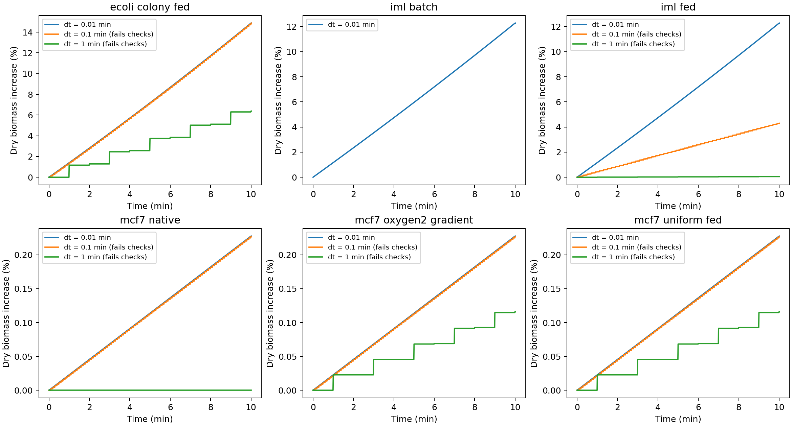

# Dynamic validation of model-specific growth conditions

All **23 serial controls completed** on MN5 (Slurm job **48054062**, one node,
8 min 16 s elapsed). **10 pass the full short-control checks; 13 do not.**
All ten passing cases use intracellular dt = diffusion dt = 0.01 min. This
identifies a usable tested candidate, not a requirement enforced by the engine
or proof of the final study's numerical accuracy.

The collector recorded 14 `completed` and 9 `completed_flagged` runs. Four of
the apparently clean runs additionally fail the post-analysis exchange ledger
check. Slurm therefore reports `FAILED` (exit 1), although all simulations
returned zero and reached their final snapshots. Failed scientific checks are
preserved alongside passing controls.

## Results and figures

- [Single-cell growth figure (PNG)](plots/single_cell_growth.png),
  [PDF](plots/single_cell_growth.pdf).
- [Summary and validation decisions](tables/summary.csv): solver failures,
  growth, negative fields, exchange residuals, update counts, runtime and memory.
- [Local initial/final concentrations](tables/local_endpoints.csv): sampled at
  each cell's actual voxel with `pctk`, in mM.
- [Biomass trajectories](tables/biomass.csv).
- [Compact per-run evidence](data/): compressed original telemetry, settings,
  input records, manifests, hardware and resource metadata.
- [Analysis provenance and checksums](analysis.json).



The plotted `dt` is the intracellular interval; diffusion dt is always 0.01 min.
“Fails checks” includes exchange-accounting errors even if the growth curve
looks similar to the reference. The y-axis scale differs between bacterial and
cancer panels. These are single-cell FBA trajectories; the pFBA and fixed-volume
controls are reported in the table.

## Findings

| Profile | Single-cell biomass increase at dt 0.01 min | 16-cell fixed-volume control at dt 0.01 min | Longer intervals |
|---|---:|---|---|
| E. coli colony fed | 14.8774% | Pass; positive LP growth at all 16,000 updates | 0.1 min fails exchange accounting; 1 min gives negative concentrations, and the population control also has solver failures |
| iML1515 fed | 12.2719% | Pass; positive LP growth at all 16,000 updates | 0.1 min gives negative oxygen; 1 min gives negative oxygen/glucose and solver failures |
| MCF7 native gradient | 0.227767% | Not tested with this profile | 0.1 min fails exchange accounting; all 10 solves fail at 1 min |
| MCF7 gradient, oxygen supply 2 mM | 0.227767% | Not tested with this profile | 0.1 min fails exchange accounting; 2 of 10 solves fail at 1 min |
| MCF7 uniform initial medium and fed boundaries, O2 2 mM | 0.227767% | Pass; positive LP growth at all 16,000 updates | 0.1 min fails exchange accounting; 2/10 single-cell and 32/160 population solves fail at 1 min |

The iML1515 closed-medium reference also passes at 0.01 min, with 12.2719%
biomass increase. Its similarity to the fed run over ten minutes does not
establish adequate nutrient supply over a longer or denser simulation.

The native-medium cancer pFBA control passes at 0.01 min with no secondary-stage
failures. Its biomass increase is the same as FBA to numerical precision, but
local final oxygen/glucose differ: approximately **0.487710/0.497267 mM for
pFBA versus 0.485764/0.496521 mM for FBA**. This is a short feasibility control;
it is not the planned replicated outcome/runtime comparison and does not show
that only runtime changes under pFBA.

**Oxygen enrichment alone does not resolve the long-timestep problem.** The
static screen established initial feasibility at 2 mM oxygen; the dynamic runs
show that this is insufficient to guarantee subsequent feasibility. The two
remaining failure events have not been independently diagnosed with exported
LPs, so they should not be attributed exclusively to oxygen limitation.

The exchange ledger compares recorded flux × diffusion-step duration with the
observed field change during cell exchange, excluding diffusion and boundary
feeding. At dt 0.01 min, maximum residuals normalized by stored field amount
are approximately 1e-14 or less. At unequal intervals, large residuals appear
(the table includes values around 0.9/0.99). This is consistent with the
[previously identified exchange-caching concern](../../timestep/pilot-20261026/README.md).
A similar biomass curve is insufficient to accept such a run.

## Changes made to the benchmark and tests

`study.json` now selects explicit **performance-only** profiles:

- E. coli: colony application SBML, five coupled fields, native uptake kinetics,
  glucose 11 mM and oxygen 10 mM with the source boundary feeding.
- iML1515: small-cell phenotype (0.338 pg), glucose 8 mM and oxygen 5 mM,
  explicit boundary supply for both nutrients and the iML1515 biomass objective.
- MCF7: all 23 fields, uniform initial supplied medium and boundary supply,
  oxygen 2 mM; native remaining nutrient levels, uptake kinetics and maintenance.

The performance candidate uses both timesteps at 0.01 min. This affects planned
benchmark inputs only. The timestep study still supports ratios 1/2/10/100;
the production code does not enforce equal timesteps. The application and
FBA/pFBA plans retain the native cancer gradient. Profile names are included in
performance case IDs and exact definitions in input provenance. Disabled and
upstream baseline inputs receive the same medium/feeding setup.

The conservation and shared-voxel inputs retain their original finite glucose
budgets and unit-test SBML. They intentionally test different conditions from
fed growth. Added regression tests verify that these inputs remain unchanged,
that cancer retains all required fields, that overrides preserve the intended
gradient or enable explicit feeding, that SBML identities are correct, and that
disabled baselines retain matching media. A new accounting test rejects excess
substrate removal even while concentration remains positive. **All nine Python
workflow tests passed.** No production C++ or original simulation inputs were
modified.

## Protocol, checks and limitations

Each simulation requested ten minutes and reached 10.01 min under the existing
sample loop. One thread, seed 50, fixed cell positions and fixed population.
Single-cell controls allow metabolic biomass growth and retain the template
domain; cancer uses the first application CSV position and three-minute
pre-diffusion preparation. Population controls freeze volume and place 16
cells on a lattice, one cell per voxel, using the performance geometry builder.
Their zero biomass change is intentional; positive LP growth is checked instead.
Observed maximum occupancy is one and due/actual update counts match in every
run. Neither fact establishes parallel safety.

Full spatial snapshots use `diagnostic_endpoints`; telemetry follows each
diffusion/intracellular update. Local concentrations are extracted only at the
endpoints; global field minima and per-cell growth are monitored throughout.
The original application pulse/source hooks are not added by this workflow.
All candidate feeding uses explicit BioFVM boundary conditions, not an interior
concentration clamp or hidden nutrient multiplier.

A passing short control requires completion without diagnostic flags, positive
growth and optimal primary status at every recorded update, matched update
counts, biomass increase when enabled, and a consistent cell-exchange ledger.
The ledger tolerance is
`1e-10 * max(1, |before|, |after|) + 1e-8 * max(|observed_delta|, |expected_delta|)`.
This accommodates floating-point subtraction/summation; it is **not** the
manuscript's biological accuracy tolerance. The ledger excludes external supply,
so it is not a full fed-system mass balance.

The final 100/1,000/10,000-cell workloads, extra-field counts, longer durations,
parallel configurations and upstream runtime baselines have not been validated
by these controls. In particular, larger domains may contain more cells far
from nutrient boundaries. These remaining checks stay explicit in the study's
open decisions. Runtime/RSS are archived for sizing jobs, not publication as
comparative performance evidence: workloads, geometry and diagnostic overhead
differ.

## Provenance and reproduction

Preparation source: `0af840a4`. Reused isolated simulation builds:
`0e66312f5eea4914d5f7634022b4e6f59e0ae04e`; simulation/harness sources are
unchanged relative to those builds and harness/binary hashes were checked.
Compiler flags include `-O3 -march=native -fopenmp -std=c++11` and
`-DPHYSICELL_BENCHMARK`. Primary solver: CLP dual simplex, primal/dual tolerances
1e-7. pFBA: fraction of optimum 1, primal secondary stage, `DFBA_PFBA_DUAL=0`.
Exact compiler, libraries, resolved architecture, hardware and binary hashes
are preserved in each manifest and hardware record. Simulations ran sequentially
on one MN5 GPP node; the allocation reserved 32 CPUs, each simulation used one.

For fresh simulations see the
[growth-validation workflow](../../../performance/README.md#model-specific-growth-validation).
The original campaign is in
`benchmarks/workspaces/growth-validation-20261026/`; it is immutable and ignored
by Git. From the repository root, in the documented analysis allocation and
activated Python environment, reproduce the tables/figure from compact evidence:

```bash
python benchmarks/performance/analyze_growth.py \
  benchmarks/results/growth_conditions/growth-20261026/data \
  --output /absolute/new-growth-analysis
```

The archived local endpoint table avoids requiring the large spatial snapshots
for this reproduction. Original snapshot hashes are retained in `analysis.json`.
Archive-based reproduction was run and all three published CSV tables matched
the original analysis byte for byte. The generated growth figure was inspected.
