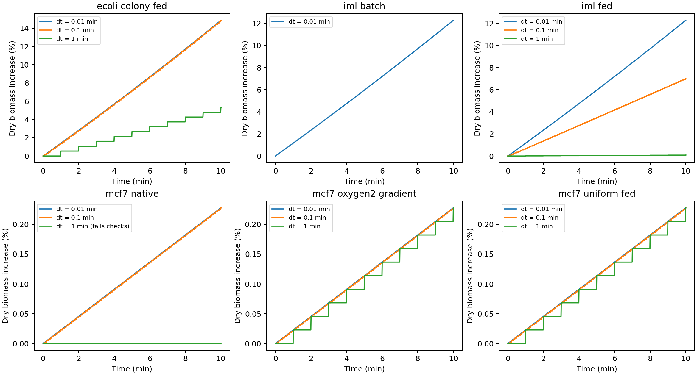

# Growth conditions, final

The 23 serial controls of the [growth-condition study](../growth-20261026/README.md) on the PR commit (`run_growth.sbatch`, job 48393482): native and fed media, single cells and 16-cell fixed-volume populations, intracellular dt 0.01/0.1/1 min. 22 of 23 pass all checks ([summary](tables/summary.csv), column `short_control_pass`); before the exchange fix, 10 did.

Part of the [final runs of 2026-11-02](../../final-20261102/README.md) (PhysiCelldFBA PR commit `c59daa81`), where the results are interpreted.

- Figures: [single_cell_growth.png](plots/single_cell_growth.png) ([PDF](plots/single_cell_growth.pdf))
- Tables: [biomass.csv](tables/biomass.csv), [local_endpoints.csv](tables/local_endpoints.csv), [summary.csv](tables/summary.csv)
- Compact per-run evidence in [data/](data/); `analysis.json` records the analysis-script and evidence hashes.
