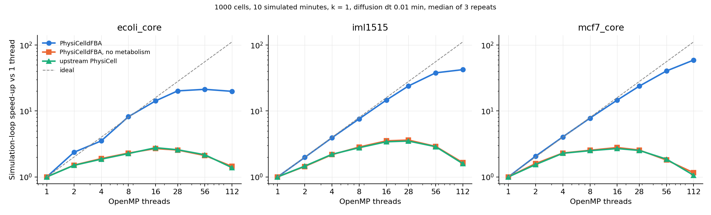
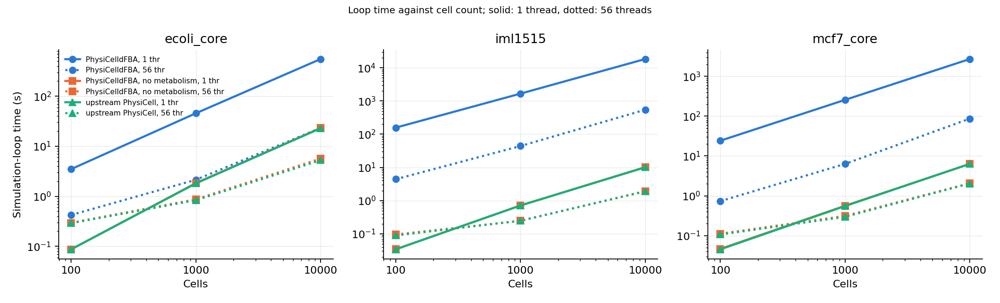

# Performance and scaling, final

[Protocol](../../../performance/FINAL_STUDIES.md#performancescaling---stage-scaling): fed-medium lattice workloads (one
cell per voxel, fixed volume and population) of E. coli core, MCF7 core and iML1515; 10 simulated minutes at
diffusion dt 0.01 with k = 1; minimal output; 3 repeats on one exclusive GPP node per point (Intel Xeon Platinum
8480+, 2 × 56 cores). Three variants with the same workload:

- **PhysiCelldFBA**: `c59daa81` with metabolism;
- **PhysiCelldFBA without metabolism**: the same binary with the intracellular model removed from the input;
- **upstream PhysiCell** `49d7cc54`, with the core-only benchmark hooks.

All 405 runs (135 points × 3 repeats) completed with the requested threads, without flags. Repeat spread (max − min over
median) is at most 10% for loops of 10 s or more and up to 25% for loops under 2 s. Timings are the
simulation loop, i.e. excluding start-up; iML1515 needs about 0.15 s per cell to load its model.

## No overhead from the add-on

PhysiCelldFBA without metabolism runs within **0.90–1.08×** of upstream PhysiCell at every point: every model, cell
count, thread count and field count. Without intracellular models the dFBA add-on adds no measurable cost. In
the figures the two baselines overlap.

## The cost of metabolism, and how it scales

| Model | µs per cell and step, 1 thread (100 / 1000 / 10 000 cells) | Loop, 1000 cells, 1 thread | Speed-up at 1000 cells: 8 / 28 / 56 / 112 threads | Speed-up at 10 000 cells, 56 threads | Peak memory at 10 000 cells |
|---|---|---:|---|---:|---:|
| E. coli core | 35 / 46 / 55 | 45.6 s | 8.2 / 20.2 / 21.3 / 19.9 | 23.8× | 1.2 GB |
| MCF7 core | 242 / 257 / 272 | 257 s | 7.8 / 23.8 / 40.6 / 59.3 | 31.4× | 4.0 GB |
| iML1515 | 1578 / 1673 / 1849 | 1675 s | 7.6 / 24.0 / 38.0 / 42.5 | 33.8× | 23.4 GB |

- **Cost is close to linear in the number of cells.** It is dominated by one LP per cell per step, and the cost per cell
  rises 12–17% from 100 to 10 000 cells for MCF7 core and iML1515, and 58% for E. coli core, whose cheap LPs leave
  more of the step to other work. Against PhysiCell without metabolism, one step costs 25× (E. coli core),
  455× (MCF7 core) and 2350× (iML1515) more at 1000 cells on one thread.
- **The LP work parallelises close to ideally up to 28 threads** (efficiency 85–86% for MCF7 core and iML1515), and
  reaches 38–41× at 56 threads and 42–59× at 112. The baselines alone gain only 2–5×, because their small
  workloads are dominated by threading overhead. With E. coli core the LPs are cheap, so the speed-up stops at about
  20× from 28 threads on, where the non-LP part dominates.
- **Field count (4–32) does not change the loop time** in these workloads (one cell per voxel, small domains)
  ([fields.png](plots/fields.png)).
- **Memory** grows with cells × model size: iML1515 needs about 2.3 GB per 1000 cells.

## Files

- Figures: [strong_scaling.png](plots/strong_scaling.png) ([PDF](plots/strong_scaling.pdf)),
  [cells.png](plots/cells.png) ([PDF](plots/cells.pdf)), [fields.png](plots/fields.png) ([PDF](plots/fields.pdf)).
- Tables: [summary.csv](tables/summary.csv) (medians, speed-up, efficiency, variant ratios, loop split),
  [runs.csv](tables/runs.csv) (every run).
- Compact per-run evidence in [data/](data/); `analysis.json` records script and evidence hashes. Builds, jobs and
  scripts: [../../final-20261102/builds/](../../final-20261102/builds/), [../../final-20261102/workflow-studies/](../../final-20261102/workflow-studies/).
