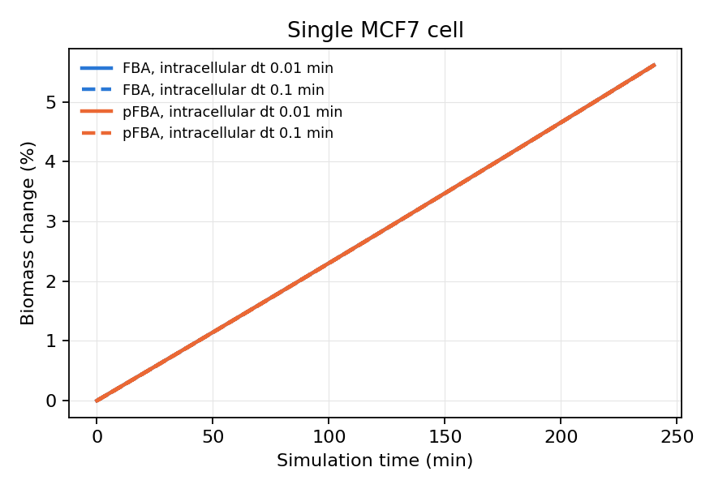
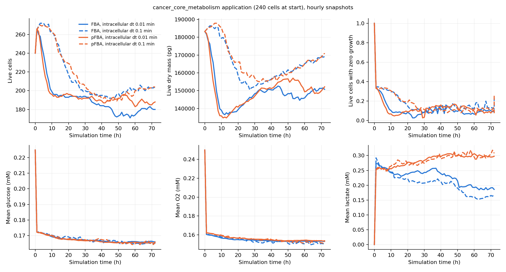

# Cancer FBA vs pFBA, final

[Protocol](../../../performance/FINAL_STUDIES.md#cancer-fba-vs-pfba---stage-pfba-8-runs): MCF7 core, standard FBA against
pFBA (parsimonious second stage, fraction of optimum 1), intracellular dt 0.01 and 0.1 min at diffusion dt 0.01, on
PhysiCelldFBA `c59daa81`. All 8 runs completed. The 4 application runs are flagged for infeasible primary solves (and
pFBA fallbacks), as described below.

## Single cell (240 min, fixed position and population, 1 thread)

| | FBA dt 0.01 | pFBA dt 0.01 | FBA dt 0.1 | pFBA dt 0.1 |
|---|---:|---:|---:|---:|
| Biomass change | 5.611976% | 5.611976% | 5.611976% | 5.611976% |
| Median total internal \|flux\| | 3020 | 15.7 | 3020 | 15.7 |
| Mean glucose / O₂ / lactate net export (BioFVM units/min per cell; 1 unit = 1 mM µm³ = 1 amol) | −1204 / −4927 / 1536 | −946 / −4254 / 959 | −1204 / −4927 / 1536 | −946 / −4254 / 959 |
| Second-stage solves (all optimal) | — | 24 000 | — | 2 400 |
| Simulation-loop time | 15.7 s | 22.9 s | 8.9 s | 9.5 s |

- **pFBA reproduces FBA's growth exactly**: biomass trajectories differ by at most 2×10⁻¹³. It picks a
  flux distribution with **192× less total internal flux**, which takes up 21% less glucose and 14% less O₂ and
  secretes 38% less lactate.
- Cost: pFBA's loop takes 1.45× FBA's at dt 0.01 and 1.07× at dt 0.1. At dt 0.1 the per-step
  diagnostics dominate this short serial run.
- dt 0.1 against 0.01: biomass within 2×10⁻⁵, exchange fluxes identical. Every run passes the exchange-ledger check.

## Application (`cancer_core_metabolism`, 240 cells, 4320 min, 56 threads, hourly snapshots)

| At 72 h | FBA dt 0.01 | pFBA dt 0.01 | FBA dt 0.1 | pFBA dt 0.1 |
|---|---:|---:|---:|---:|
| Live / dead cells | 180 / 169 | 188 / 170 | 204 / 145 | 204 / 143 |
| Live dry mass (×10⁵ pg) | 1.51 | 1.52 | 1.69 | 1.71 |
| Mean lactate (mM) | 0.186 | 0.298 | 0.167 | 0.308 |
| Infeasible primary solves (whole run) | 11.7% | 12.0% | 22.3% | 22.1% |
| pFBA second-stage fallbacks | — | 602 of 74.7 M | — | 9 of 7.2 M |
| Wall time | 33.8 min | 44.1 min | 3.9 min | 7.6 min |

Findings:

- **FBA and pFBA give the same tumour dynamics within run-to-run variation.** Live cells and biomass track each other
  for about 40 h, then drift apart by up to 13% (cells) and 8% (biomass). Division and death are stochastic and there
  is one run per condition, so this drift cannot be separated from random variation without replicates.
- **pFBA's systematic signature is lactate.** Domain lactate ends 1.6× (dt 0.01) to 1.8× (dt 0.1) higher than with
  FBA. Mean glucose and O₂ are identical. In the single cell, by contrast, pFBA secretes less lactate. The
  exchange chosen among equally optimal solutions therefore depends on the local environment.
- **pFBA costs 1.3× (dt 0.01) to 2.0× (dt 0.1)** FBA's wall time. Second-stage failures, where the cell keeps its
  stage-one fluxes, occur in 8×10⁻⁶ (dt 0.01) and 1×10⁻⁶ (dt 0.1) of the second-stage solves.
- **The intracellular timestep changes the application, unlike the single cell.** At dt 0.1 the early die-off is
  delayed by about 10 h, the population ends 9–13% larger, and twice as many primary solves are infeasible.
  FBA and pFBA shift in the same way, so the effect is systematic. Cells here are crowded and O₂ is low (≈0.15 mM),
  which is where the [window-demand rule](../../final-20261102/README.md#2-timestep-accuracy-part-a-what-running-the-metabolism-less-often-costs-in-accuracy)
  predicts errors. dt 0.1 is 8.7× (FBA) or 5.8× (pFBA) faster in wall time, but in this application it is not equivalent to 0.01.
- **About 12% of all primary solves are infeasible even at dt 0.01** (34% in the first simulated hour). This is a
  property of the shipped sample, not of the benchmark: its inputs are staged unchanged (`.mat` initial and boundary
  files disabled, 19 Dirichlet conditions kept). Infeasible cells are flagged for metabolic death.

## Files

- Figures: [single_biomass.png](plots/single_biomass.png) ([PDF](plots/single_biomass.pdf)),
  [application.png](plots/application.png) ([PDF](plots/application.pdf)).
- Tables: [single_runs.csv](tables/single_runs.csv), [application_runs.csv](tables/application_runs.csv),
  [application_trajectories.csv](tables/application_trajectories.csv) (hourly), [comparisons.csv](tables/comparisons.csv)
  (pFBA against FBA at the same dt, and dt 0.1 against 0.01 for the same objective).
- Compact per-run evidence in [data/](data/); `analysis.json` records script and evidence hashes. Jobs and scripts:
  [../../final-20261102/workflow-studies/](../../final-20261102/workflow-studies/).
