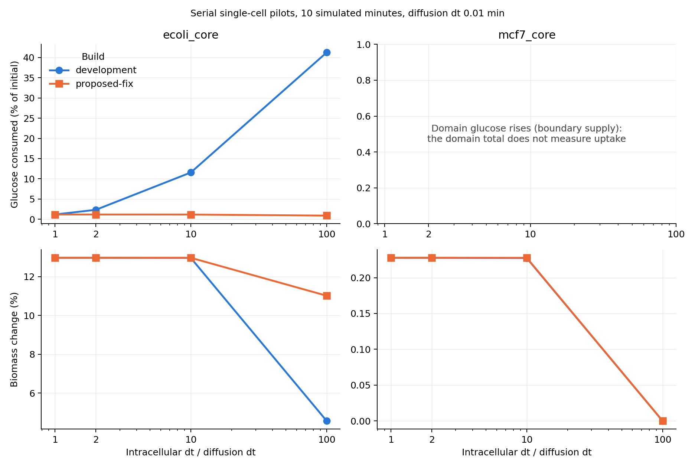

# Intracellular-dt exchange scaling: development vs. proposed fix

The 11 serial timestep pilots of [pilot-20261026](../pilot-20261026/README.md) were
repeated with an unchanged protocol on two builds of PhysiCelldFBA `development` @
`a2519f06` with the benchmark hooks:

- **development**: as merged ([report](../pilot-dev-20261027/)).
- **proposed-fix**: plus [`proposed-fixes/intracellular-dt-exchange.patch`](../../../performance/proposed-fixes/README.md),
  which is **not merged upstream** ([report](../pilot-fix-20261027/)).

The defect: after each FBA solve, `update_dfba_outputs` called
`set_internal_uptake_constants(dfba_time_step)`, and BioFVM applied the resulting
per-step exchange at **every diffusion step**. With intracellular dt = k × diffusion
dt, each dFBA window therefore exchanged k times the FBA flux. The patch builds the
constants for `diffusion_dt`.

[PDF](plots/pilot_builds.pdf) · [all values](tables/builds_by_ratio.csv) · [comparison record](comparison.json)

## E. coli core (10 mM glucose, single cell, 10 min)

| Ratio | Glucose used, development | Glucose used, proposed fix | Biomass, development | Biomass, proposed fix | Exchange balance (dev / fix) |
|---:|---:|---:|---:|---:|---|
| 1 | 1.167% | 1.167% | 12.97218% | 12.97218% | pass / pass |
| 2 | 2.331% (×2.00) | 1.166% (×1.00) | 12.97168% | 12.97218% | FAIL / pass |
| 10 | 11.56% (×9.91) | 1.156% (×0.99) | 12.96687% | 12.97218% | FAIL / pass |
| 100 | 41.24% (×35.4), min −1.11 mM | 0.898% (×0.77) | 4.561% | 11.016% | FAIL / pass |

×: glucose used relative to ratio 1 of the same build.

## MCF7 core (cancer, single cell, 10 min after 3 min pre-equilibration)

| Ratio | Biomass, development | Biomass, proposed fix | Exchange balance (dev / fix) | Primary LP failures |
|---:|---:|---:|---|---:|
| 1 | 0.22777% | 0.22777% | pass / pass | 0 / 0 |
| 2 | 0.22772% | 0.22777% | FAIL / pass | 0 / 0 |
| 10 | 0.22738% | 0.22777% | FAIL / pass | 0 / 0 |
| 100 | 0 | 0 | pass / pass | 10 / 10 (infeasible) |

Domain glucose rises in this setup (boundary supply), so the domain total does not
measure uptake and is not plotted. The three refinement runs (both timesteps equal)
have identical trajectories in both builds.

## Findings

1. **The defect is confirmed and the patch removes it.** In the development build,
   glucose use scales with the ratio and the exchange balance fails at every ratio
   above 1. With the patch, glucose use at ratios 2 and 10 matches ratio 1 within
   1%, and every run passes the exchange balance.
2. **No effect at ratio 1.** Ratio-1 trajectories (dry mass, minimum and mean glucose
   at all 1001 samples) are bitwise-identical between builds for both models, as are
   the three cancer refinement runs. The development build also reproduces the
   original pilot values exactly (those were serial, so PR #19 does not apply).
3. **Biomass alone would not have detected it** below ratio 100: development biomass
   at ratios 2 and 10 is within 0.006 percentage points of ratio 1 for E. coli, while
   glucose use is 2× and 10× too high.
   Substrate accounting must be part of any timestep accuracy criterion.
4. **With the patch, the remaining error at ratio 100 comes from the uptake cap.** E.
   coli growth is already lower at the first update (μ = 0.666 vs. 0.732 h⁻¹ at ratio
   1) while glucose is 10 mM, 500× Km, so Michaelis–Menten saturation is not the cause.
   With 1.6 µm voxels, the cap limits uptake over a 1-minute window to the content of
   the cell's own voxel, with no credit for diffusion during the window. The cancer
   ratio-100 infeasibility has the same origin with oxygen
   ([diagnosis](../pilot-20261026/diagnosis/README.md)). This is a design property of
   the cap, unaffected by the patch, and is part of what the timestep trade-off study
   has to quantify.

## Provenance

Simulation jobs 48115174 (development) and 48115175 (proposed fix), one exclusive MN5
GPP node each, 59 s. Flagged runs: development 2 (E. coli ratio 100 negative glucose;
cancer ratio 100 infeasible), proposed fix 1 (cancer ratio 100). Builds: benchmark
repository `f42b22d`, GCC 11.5.0, `-O3 -march=native -fopenmp`. Binary hashes, applied
patches and harness digests are in each report's `data/*/manifest.json`. Comparison:
[`performance/compare_pilots.py`](../../../performance/compare_pilots.py).
