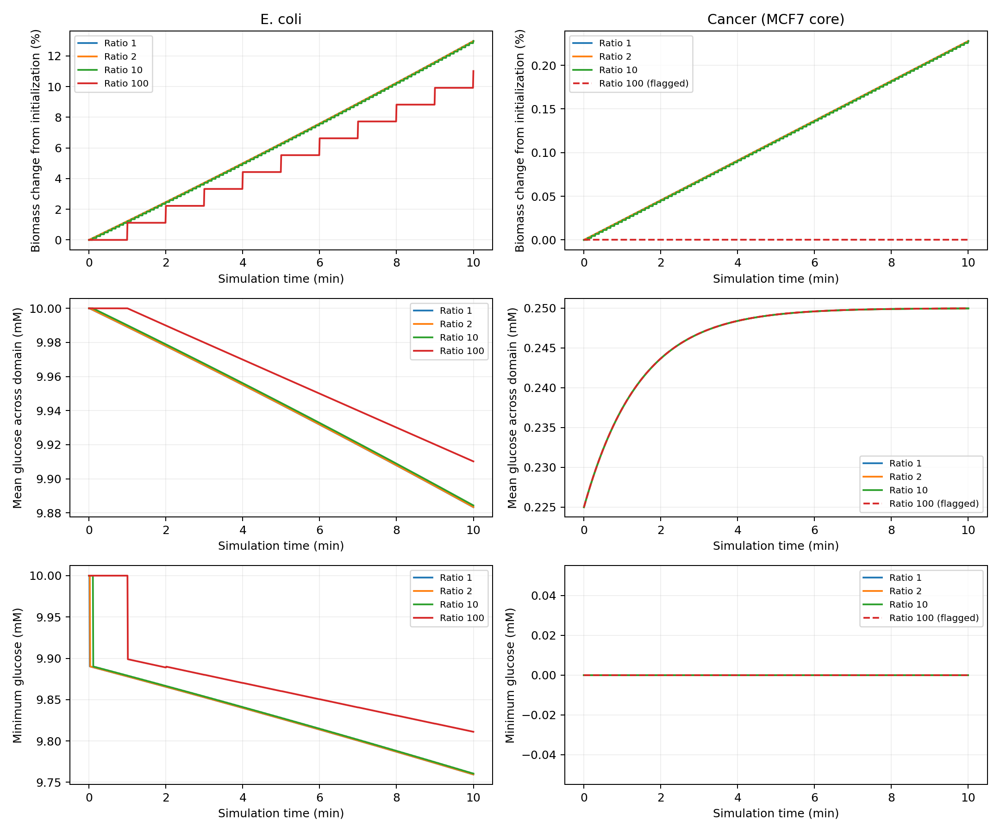

# Serial timestep pilots: proposed-fix build

The 11 pilots of [pilot-20261026](../pilot-20261026/README.md) with an unchanged protocol on
PhysiCelldFBA `development` @ `a2519f06` with the benchmark hooks and the [proposed exchange fix](../../../performance/proposed-fixes/README.md) (not merged upstream). Job 48115175. Exported by `analyze_pilots.py`; the comparison of both builds and its
interpretation are in the [exchange-fix report](../exchange-fix-20261027/README.md).

- [Timestep outcomes](plots/timestep_outcomes.png) ([PDF](plots/timestep_outcomes.pdf)): biomass
  and glucose against time for each ratio and model.
- [Cancer reference refinement](plots/cancer_refinement.png) ([PDF](plots/cancer_refinement.pdf)):
  equal timesteps at 0.01, 0.005 and 0.0025 min.
- Tables: [outcomes](tables/outcomes.csv), [trajectories](tables/trajectories.csv),
  [per-update solver statuses](tables/intracellular_updates.csv). Compact evidence in [data/](data/).
