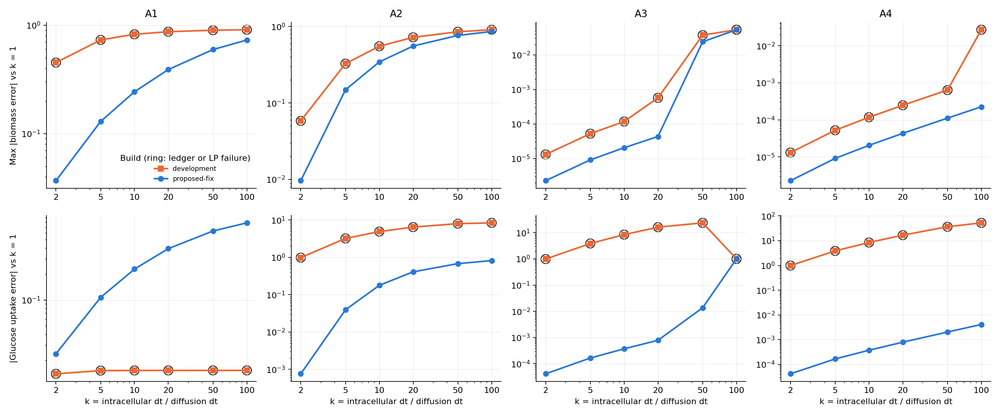

# Timestep trade-off, Part A: accuracy

Part A of the [trade-off protocol](../../../performance/TIMESTEP_TRADEOFF.md): scenarios
A1–A4 at k = intracellular dt / diffusion dt = 1, 2, 5, 10, 20, 50, 100 (diffusion dt
0.01 min), 240 simulated minutes, serial, fixed positions and population, biomass growth
on. Two builds of PhysiCelldFBA `a2519f06` with the benchmark hooks:

- **proposed-fix**: with [`intracellular-dt-exchange.patch`](../../../performance/proposed-fixes/README.md), not merged upstream (job 48120561);
- **development**: as merged (job 48120562).

All 58 runs completed. Errors are relative to k = 1 of the same build and scenario. Uptake
is the substrate the cells actually removed, from the exchange ledger.

[PDF](plots/accuracy.pdf) · [k = 1 trajectories of A1–A4](plots/checks.png) ([PDF](plots/checks.pdf); the
two builds coincide at k = 1) · [all runs](tables/runs.csv) · [1-minute trajectories](tables/trajectories_1min.csv).
Rings mark runs that fail the exchange-ledger check or contain non-optimal LP updates.

| Scenario | Regime | Voxel |
|---|---|---|
| A1 E. coli core, 1 cell, 10 mM glucose | Depleting | 1.6 µm |
| A2 E. coli core, 16 cells, fed | Fed | 2 µm |
| A3 MCF7 core, 1 cell | Saturated | 15 µm |
| A4 MCF7 core, 16 cells, fed | Saturated | 15 µm |

## Proposed-fix build: final biomass error vs. k = 1

| k | A1 | A2 | A3 | A4 | Wall time A4 (s) |
|---:|---:|---:|---:|---:|---:|
| 1 | 0 | 0 | 0 | 0 | 118.0 |
| 2 | −2.2% | −0.95% | 4×10⁻¹⁰ | 4×10⁻¹⁰ | 61.0 |
| 5 | −9.8% | −14.9% | 2×10⁻⁹ | 2×10⁻⁹ | 26.6 |
| 10 | −20.9% | −34.4% | 4×10⁻⁹ | 4×10⁻⁹ | 15.7 |
| 20 | −36.1% | −55.6% | 9×10⁻⁹ | 9×10⁻⁹ | 9.8 |
| 50 | −57.9% | −76.4% | −2.4% | 2×10⁻⁸ | 6.2 |
| 100 | −71.9% | −86.1% | −5.3% (all LPs infeasible) | 4×10⁻⁸ | 5.2 |

All 29 proposed-fix runs pass the exchange-ledger check and have no negative
concentrations. The only non-optimal LPs are in A3 at k = 100: oxygen-budget
infeasibility, as in the [pilots](../exchange-fix-20261027/README.md). The A3 reference at
diffusion dt 0.005 min differs from dt 0.01 min by 5×10⁻⁶ in final biomass and 0.33% in
glucose uptake.

## What sets the error: window demand versus voxel content

With the fix, results depart from k = 1 once the uptake cap binds. The cap limits each
cell's uptake over one intracellular window to what its voxel holds. Defining

  D = Vmax × m_cell × Δt_intracellular / (c_voxel × V_voxel)

for the limiting substrate, the biomass error first exceeds 0.1% at nearly the same D for
every k:

| k | A1 onset (min) | A1 cell mass (pg) | A1 D (glucose) | A2 onset (min) | A2 cell mass (pg) | A2 D (oxygen) |
|---:|---:|---:|---:|---:|---:|---:|
| 2 | 182 | 3.10 | 0.77 | 230 | 8.21 | 1.09 |
| 5 | 163 | 2.46 | 0.92 | 182 | 4.22 | 1.09 |
| 10 | 138 | 1.82 | 0.98 | 139 | 2.32 | 1.08 |
| 20 | 104 | 1.20 | 1.02 | 93 | 1.23 | 1.08 |
| 50 | 47 | 0.60 | 1.05 | 29 | 0.51 | 1.08 |
| 100 | 1 | 0.34 | 1.11 | 1 | 0.34 | 1.45 (already > 1 at the first window) |

D uses the domain-mean concentration and saturated uptake (Vmax). In A1, late in
depletion, the cell's own voxel holds less than the mean, which explains D < 1 at k = 2.
In A2, oxygen (Vmax 20) binds before glucose (Vmax 10).

**A k that is safe in one model or geometry may be wrong in another.** What matters is D:
cell mass and Vmax against the voxel volume and concentration. Users can check
Δt_intracellular < c·V_voxel / (Vmax·m_cell) for each consumed substrate before choosing
a timestep. Cancer cells in 15 µm voxels stay below D = 1 up to k = 20 (A3) and k = 100
(A4, fed). E. coli in 1.6–2 µm voxels exceeds it as soon as the cells grow.

**Caveat.** Population is fixed, so cells never divide: in A1 the cell grows from 0.34 to
4 pg, and in A2 from 0.34 to 9.4 pg per cell. That drives D up over time and makes the
late, large errors in A1–A2 more severe than in a simulation with division, where cell
mass stays near the birth-to-division range. The onset rule is unaffected; the
magnitudes at 240 min are an upper bound for these geometries.

## Development build

Of the 24 development runs with k > 1, 23 fail the exchange-ledger check. The exception
is A3 at k = 100, where every LP is infeasible and nothing is exchanged. 11 have negative
concentrations (down to −3.85 mM glucose in A2), and 7 have primary-LP failures. Glucose
uptake reaches 54× the k = 1 value (A4, k = 100). Biomass alone hides this in the
saturated scenarios. In A3–A4 at k ≤ 20 the development biomass error stays below
6×10⁻⁴, while glucose uptake is 2–18× the k = 1 value. In A1 the defect consumes the glucose early,
starving later growth (−45% biomass at k = 2). These runs document the defect. They do
not describe the method.

## Provenance

Campaigns prepared with `prepare_tradeoff.py --stage accuracy --duration 240` from
benchmark repository `c3b456c`; builds as in the [check stage](../tradeoff-checks-20261027/README.md)
(binary hashes and applied patches in each run's `data/*/*/manifest.json`). Analysis:
[`analyze_tradeoff.py`](../../../performance/analyze_tradeoff.py).
