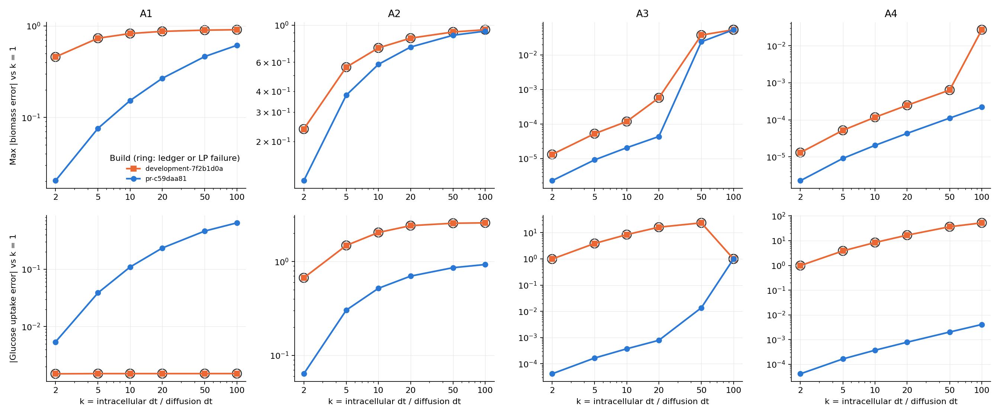

# Timestep accuracy, diffusion dt 0.01 min, final

Part A of the [trade-off protocol](../../../performance/TIMESTEP_TRADEOFF.md): scenarios A1–A4, k = 1–100, 240 simulated minutes, on the PR commit (`pr-c59daa81`) and the unfixed `development-7f2b1d0a`. Rings mark runs failing the exchange-ledger check or with non-optimal LPs. [k = 1 trajectories](plots/checks.png).

Part of the [final runs of 2026-11-02](../../final-20261102/README.md) (PhysiCelldFBA PR commit `c59daa81`), where the results are interpreted.

- Figures: [accuracy.png](plots/accuracy.png) ([PDF](plots/accuracy.pdf)), [checks.png](plots/checks.png) ([PDF](plots/checks.pdf))
- Tables: [runs.csv](tables/runs.csv), [trajectories_1min.csv](tables/trajectories_1min.csv)
- Compact per-run evidence in [data/](data/); `analysis.json` records the analysis-script and evidence hashes.
