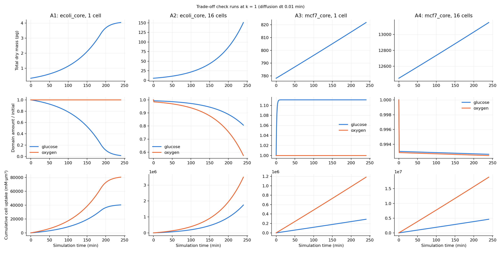

# Timestep trade-off: check stage

Stage `checks` of the [trade-off protocol](../../../performance/TIMESTEP_TRADEOFF.md), run on
the proposed-fix build (PhysiCelldFBA `a2519f06` + hooks +
[`intracellular-dt-exchange.patch`](../../../performance/proposed-fixes/README.md)). Job
48119426, 7 serial cases, 18.6 min on one exclusive GPP node. All runs completed with no
diagnostic flags, every LP update was optimal, and every run passes the exchange-ledger check.

[PDF](plots/checks.pdf) · [runs](tables/runs.csv) · [1-minute trajectories](tables/trajectories_1min.csv)

Uptake is the substrate the cells actually removed: the sum of the exchange ledger's
observed changes during the cell-exchange step. Unlike the domain total, it is not hidden
by boundary supply.

## Scenarios A1–A4 at k = 1, 240 min

| Scenario | Biomass change | Substrate regime | Wall time |
|---|---:|---|---:|
| A1 E. coli core, 1 cell, 1.6 µm voxels, 10 mM glucose | +1094% | Glucose depletes: domain 50% at 154 min, 10% at 202 min; μ falls from 0.73 to 0.04 h⁻¹ | 4.7 s |
| A2 E. coli core, 16 cells, 2 µm voxels, fed | +2690% | Fed: glucose ≥ 8.4 mM, oxygen ≥ 4.8 mM | 17.6 s |
| A3 MCF7 core, 1 cell, 15 µm voxels | +5.61% | Saturated: μ constant at 0.01365 h⁻¹ | 15.6 s |
| A4 MCF7 core, 16 cells, 15 µm voxels, fed | +5.61% | Saturated: μ constant at 0.01365 h⁻¹ | 118 s |

**Decision: Part A runs 240 simulated minutes.** A1 covers the transition from abundant to
depleted glucose, A2 steady feeding, and A3–A4 the nutrient-saturated regime. In A3–A4
μ is about half of `max_growth_rate` (0.0268 h⁻¹), so growth is not at that ceiling. It is
identical in both media because the uptake bounds are near Vmax. In this regime only the
uptake cap can make the result depend on k.

## iML1515, 1 cell, fed medium, 60 min

| k | LP updates | Biomass change | Final biomass vs k = 1 | Glucose uptake vs k = 1 | Wall time |
|---:|---:|---:|---:|---:|---:|
| 1 | 6000 | +100.3% | — | — | 326 s |
| 10 | 600 | +44.7% | −27.8% | −15.8% | 313 s |
| 100 | 60 | +0.5% | −49.8% | −88.0% | 313 s |

- **iML1515 is usable on the fixed build.** No flags, no LP failures and a passing exchange
  balance at every k. The negative concentrations and solver failures in the
  [growth-condition study](../../growth_conditions/growth-20261026/README.md) at 0.1 and 1 min
  were therefore the exchange defect. Those unequal-timestep results should be re-run on a
  fixed build before they are cited.
- **Accuracy falls quickly with k in this geometry.** The `ecoli_acetic_switch` template has
  1 µm voxels, so the uptake cap limits each window to a very small voxel content, with no
  diffusion credit. E. coli core in 1.6 µm voxels loses no biomass at k = 10 over 10 min
  ([pilots](../exchange-fix-20261027/README.md)).
- **No time is saved here.** The single cell sits in the application's full domain, so
  diffusion dominates the run time. Part B's lattice workloads (1000 cells, one per voxel)
  measure the LP share where it matters.

## Provenance

Prepared with `prepare_tradeoff.py --stage checks --duration 240` (iML1515 cases capped at
60 min) from benchmark repository `f563e50`. Build records are in each run's
`data/*/*/manifest.json`. Analysis: [`analyze_tradeoff.py`](../../../performance/analyze_tradeoff.py).
