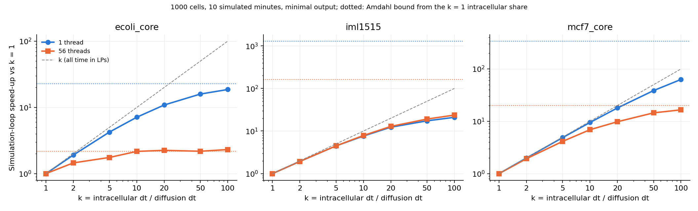

# Timestep cost, diffusion dt 0.01 min, final

Part B: 1000-cell workloads of E. coli core, MCF7 core and iML1515, k = 1–100, 1 and 56 threads, 3 repeats, 10 simulated minutes, minimal output, on the PR commit. Dotted lines: Amdahl bound from the k = 1 intracellular share; dashed: k.

Part of the [final runs of 2026-11-02](../../final-20261102/README.md) (PhysiCelldFBA PR commit `c59daa81`), where the results are interpreted.

- Figures: [cost.png](plots/cost.png) ([PDF](plots/cost.pdf))
- Tables: [runs.csv](tables/runs.csv), [summary.csv](tables/summary.csv)
- Compact per-run evidence in [data/](data/); `analysis.json` records the analysis-script and evidence hashes.
