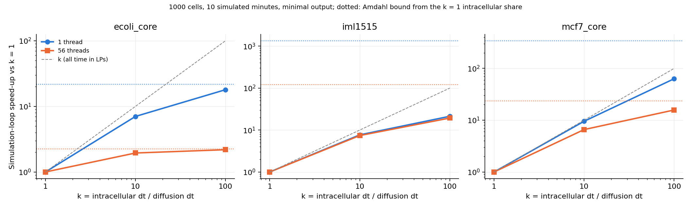

# Timestep trade-off, Part B pilot: cost

Pilot for Part B of the [trade-off protocol](../../../performance/TIMESTEP_TRADEOFF.md), on the
proposed-fix build ([build details](../tradeoff-checks-20261027/README.md#provenance)). The 1000-cell
performance workloads (lattice, one cell per voxel, fed medium, fixed volume, minimal output,
10 simulated minutes, diffusion dt 0.01 min) of E. coli core, MCF7 core and iML1515, at
k = 1, 10, 100 and 1 or 56 threads, one repeat. Job 48120584: all 18 cases completed with
the requested thread count, without diagnostic flags or solver failures, in 56 min.

[PDF](plots/cost.pdf) · [summary](tables/summary.csv) · [runs](tables/runs.csv) · compact evidence in [data/](data/).
Dotted lines: the Amdahl bound, loop / (loop − intracellular) at k = 1. Dashed line: k.

## Simulation-loop time (s) and speed-up over k = 1

| Model | Threads | k = 1 | k = 10 | k = 100 | Intracellular share at k = 1 |
|---|---:|---:|---:|---:|---:|
| E. coli core | 1 | 43.7 | 6.22 (7.0×) | 2.43 (18×) | 95% |
| E. coli core | 56 | 1.72 | 0.88 (2.0×) | 0.79 (2.2×) | 56% |
| MCF7 core | 1 | 257.5 | 27.0 (9.5×) | 4.08 (63×) | 99.7% |
| MCF7 core | 56 | 6.52 | 0.99 (6.6×) | 0.41 (16×) | 96% |
| iML1515 | 1 | 1668 | 217 (7.7×) | 78.4 (21×) | 99.9% |
| iML1515 | 56 | 32.6 | 4.40 (7.4×) | 1.69 (19×) | 99% |

## Findings

1. **The saving depends on the LP share.** With small networks on many threads the LP is
   already cheap. E. coli core at 56 threads cannot gain more than 2.25× from any k, and
   reaches 2.2× at k = 100. With larger networks or fewer threads, LP time dominates and
   k pays off.
2. **For large networks, solves get more expensive as k grows.** Each cell's LP is
   warm-started from its previous solution. The bounds change little between consecutive
   solves at k = 1 and much more at k = 100:

   | Model (1 thread) | Time per solve, k = 1 → 10 → 100 | Simplex iterations per solve | Intracellular speed-up at k = 100 |
   |---|---|---|---:|
   | E. coli core | 35 → 36 → 38 µs | 0 → 0.04 → 0.30 | 90× |
   | MCF7 core | 217 → 223 → 299 µs | 0.02 → 0.23 → 2.3 | 75× |
   | iML1515 | 1.5 → 2.0 → 7.6 ms | 0.46 → 5.0 → 54 | 21.5× |

   For iML1515, 100× fewer solves save 21.5× intracellular time. The speed-up from k is
   therefore model-dependent and below k for genome-scale networks.
3. Combined with Part A, the useful range of k is where the speed-up has not yet
   saturated and the window-demand ratio D stays below 1
   ([accuracy report](../tradeoff-accuracy-20261027/README.md)).

## Sizing the full Part B

All 7 ratios × 3 repeats × 2 thread counts × 3 models = 126 runs. Interpolating the
pilot's loop times gives about 3 h for the 21 single-thread iML1515 runs, 25 min for
single-thread MCF7, and under 15 min for everything else, plus per-run start-up. **Estimate:
about 4 h on one exclusive node; request 6 h.**

## Provenance

Prepared with `prepare_tradeoff.py --stage cost-pilot --duration 10` from benchmark repository
`38fe9de`. Analysis: [`analyze_cost.py`](../../../performance/analyze_cost.py). Telemetry
fields: `simulation_loop_seconds`, `intracellular_seconds`, `solver_thread_seconds`,
`stage_one_solve_calls` and `stage_one_iterations` from each run's `benchmark_metrics.json`.
