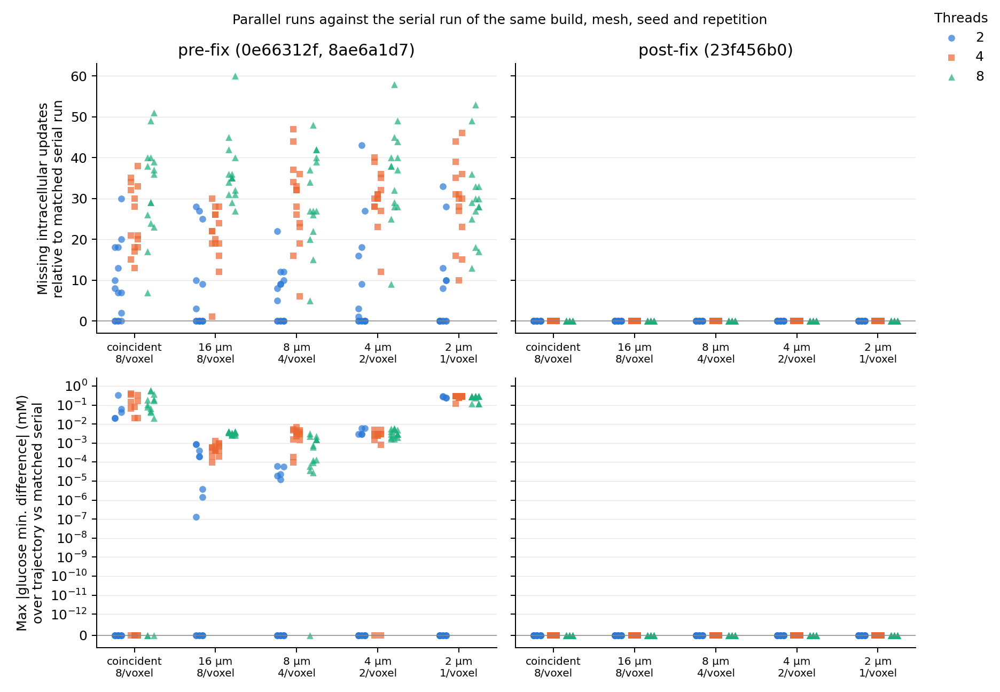

# Shared-voxel and mesh diagnostics before and after the PR #19 race fixes

The 60-run coincident-cell campaign and the 240-run separated-cell mesh campaign
were repeated, with unchanged protocols, on a build that includes PR #19
(`fix/parallel-race-conditions`, merged into `development` as `a2519f06`):

1. `core/PhysiCell_cell_container.cpp`: `update_all_cells_intracellular` records
   which cells are due for an update in a `std::vector<char>` instead of a
   bit-packed `std::vector<bool>` written from an `omp parallel for`.
2. `BioFVM/BioFVM_basic_agent.cpp`: the read-modify-write of a voxel's density
   vector in `simulate_secretion_and_uptake` is guarded by a pool of 4096 OpenMP
   locks indexed by voxel.

These are hypotheses 1 and 2 of the [pre-fix mesh report](../mesh-20261026/README.md).
The new reports are [voxel-20261027](../voxel-20261027/) and
[mesh-20261027](../mesh-20261027/); the pre-fix reports are
[voxel-20261026](../voxel-20261026/README.md) and [mesh-20261026](../mesh-20261026/README.md).

## Result



[PDF](plots/before_after.pdf). Each point is one parallel run, compared with the serial
run of the same build, geometry, order seed and repetition. The lower panel uses a
symmetric-log axis so that exact zeros are visible.

| | Pre-fix | Post-fix |
|---|---:|---:|
| Parallel runs (2/4/8 threads, 5 geometries) | 225 | 225 |
| Runs missing intracellular updates vs. serial | 187 | **0** |
| Largest deficit (of 80 updates) | 60 | **0** |
| Runs failing the glucose exchange-balance check | 119 | **0** |
| Runs bitwise-identical to their serial match (updates, glucose trajectory, final per-cell dry mass) | 35 | **225** |
| Largest glucose-minimum difference vs. serial (mM) | 0.598 | **0** |
| Lowest glucose in any parallel run (mM) | −0.598 | −3.78×10⁻⁶ (= serial) |
| Serial runs identical across the two builds | — | 75/75 |

Per geometry and thread count, see [tables/summary.csv](tables/summary.csv);
every attempt is in [tables/attempts.csv](tables/attempts.csv) and the serial
cross-build comparison in [tables/serial_across_builds.csv](tables/serial_across_builds.csv).
All 300 post-fix runs completed with the requested thread count and fixed population;
the only diagnostic flag raised is `negative_concentration`, in the 60 coincident-cell
runs and the 60 runs on the 2 µm mesh, serial and parallel alike (see below).

### What the pre-fix data attribute to each race

- On the 2 µm mesh every cell has its own voxel, so voxel density updates cannot
  collide. Pre-fix, those runs still missed up to 53 updates and reached −0.287 mM,
  with **zero** exchange-balance failures. The lost update flags alone (fix 1) were
  enough to drive glucose strongly negative: a cell that misses its update keeps
  exporting its stale uptake rate after its voxel has been drained.
- Exchange-balance failures occurred only where cells shared a voxel (8, 4 or 2 per
  voxel), consistent with lost concurrent density updates (fix 2).
- After both fixes neither signature remains at any occupancy or thread count.

### Independent check: the PR's own update-order test

`sample_projects_intracellular/fba/dfba_unit_test/scripts/run_voxel_sharing_test.sh`
was run on two isolated trees built with the stock unit-test `main` (no benchmark
hooks): the current source, and the same source with only the two PR #19 files
restored from `b0d810b4`. It places 12 cells of four types (different volume and
glucose Vmax) in one voxel in five creation orders, at 1 and 4 threads, and requires
agreement with the 1-thread identity order within 1e-9.

| Tree | Exit | 4-thread runs within 1e-9 of serial | Largest difference | Lowest concentration (mM) |
|---|---:|---:|---:|---:|
| Post-fix | 0 (PASS) | 5/5 | 1.1×10⁻¹⁵ | −3.36×10⁻⁶ |
| PR #19 reverted | 1 (FAIL) | 0/5 | 1.33 | −0.280 |

In both trees the serial runs and the pre-existing n1/n4/n8/mixed voxel-sharing
checks pass identically: those serial checks cannot detect the races. Logs and
binary/source hashes are in [independent_update_order_test/](independent_update_order_test/).

## Interpretation and limits

- **Bitwise identity here partly reflects identical cells.** All eight benchmark cells
  have the same type and initial mass, so they export identical amounts and the
  per-voxel sum does not depend on the order in which the locks are taken. With
  heterogeneous cells, floating-point addition order still varies: the update-order
  test shows differences of ~1e-15 between cell orders even at one thread. Post-fix
  parallel results should be described as equal to serial up to rounding, not as
  bitwise reproducible in general.
- These are short (0.1 min) stress tests with 8 or 12 cells. They show that the two
  identified races are removed, not that the code is race-free. No race detector
  (e.g. ThreadSanitizer) was run.
- Other `omp parallel` regions in PhysiCell (mechanics, phenotype, division and
  removal) were not exercised: positions and population are fixed in the benchmark.
- Wall times are not performance measurements; the effect of the locks on scaling
  belongs in the performance study.

## Remaining serial undershoot

Both builds, at every thread count, give the same small negative glucose in the
coincident case (−3.78×10⁻⁶ mM) and on the 2 µm mesh (−1.19×10⁻⁶ mM). It is
deterministic and is reproduced exactly by the following mechanism in
`addons/dFBA/src/dfba_intracellular.cpp`:

- `update_dfba_inputs` caps uptake so that the voxel's demand over one window equals
  its content, using the cell's dry mass **before** growth;
- `update_dfba_outputs` then grows the cell by `exp(μ·dt)` and converts the flux to a
  net export rate using the dry mass **after** growth.

When the cap binds, the removed amount therefore exceeds the content by
`c·(exp(μ·dt) − 1)`:

| Case | Glucose before the draining step (mM) | μ at that update (h⁻¹) | Predicted (mM) | Observed (mM) |
|---|---:|---:|---:|---:|
| Coincident, 8 cells | 0.165 | 0.137465 | −3.7803×10⁻⁶ | −3.7803×10⁻⁶ |
| 2 µm mesh, 1 cell/voxel | 0.0234069 | 0.304605 | −1.1883×10⁻⁶ | −1.1883×10⁻⁶ |

The relative overshoot is μ·dt (≈2–5×10⁻⁵ here) and shrinks with the timestep. It is
not a concurrency effect and is outside PR #19. Using one mass consistently for the
cap and the export would remove it; this change was not made or tested here.

## Provenance and reproduction

| Step | Slurm job | Notes |
|---|---|---|
| Build, preparation, 10 preflights | 48112650 (`gp_debug`) | [workflow/build_prepare.sh](workflow/build_prepare.sh), [preflight log](workflow/preflight.log) |
| 60 coincident-cell runs | 48112700 (`gpp`, exclusive) | Slurm `FAILED` = flagged diagnostics retained; all 60 completed |
| 240 mesh runs | 48112701 (`gpp`, exclusive) | as above; all 240 completed |
| Independent update-order test | 48112910 (`gp_debug`) | [independent_update_order_test/run.sh](independent_update_order_test/run.sh) |
| Report export and mesh summary | 48113002 (`gp_debug`) | exports succeeded; the comparison step failed on a missing `mesh_id` column in the older report ([log](workflow/analysis.log)) |
| Before/after comparison | 48113012 (`gp_debug`) | after `compare_builds.py` treated a missing `mesh_id` as `original` ([log](workflow/compare.log)) |

Source `23f456b0` (merge of `origin/development` at `a2519f06`, plus the benchmark
preparation commit), clean tree (`source.patch` empty), GCC 11.5.0,
`-O3 -march=native ... -fopenmp -DPHYSICELL_BENCHMARK`, Sapphire Rapids; binary
SHA-256 `c74353427dee…` (full record in the campaign reports' `build.json`).
Protocols are byte-identical to the pre-fix campaigns. The pre-fix reports used
`8ae6a1d7` (coincident) and `0e66312f` (mesh); their serial runs match the post-fix
serial runs exactly. Analysis: Python 3.12.1, Matplotlib 3.10.8, NumPy 2.4.4.

```bash
python benchmarks/voxel_sharing/compare_builds.py \
  --before benchmarks/results/voxel_sharing/voxel-20261026 benchmarks/results/voxel_sharing/mesh-20261026 \
  --after  benchmarks/results/voxel_sharing/voxel-20261027 benchmarks/results/voxel_sharing/mesh-20261027 \
  --labels pre-fix post-fix --output /path/to/new-directory --plots
```
