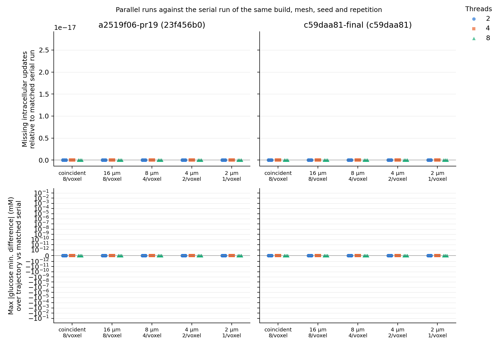

# Final voxel and mesh runs against 2026-10-27

`compare_builds.py` with the 2026-10-27 reports (PhysiCelldFBA `a2519f06`, after PR #19) as *before* and the final reports as *after*. All 75 serial runs are identical across the two versions ([comparison.json](comparison.json)); every parallel run of both equals its serial match.

Part of the [final runs of 2026-11-02](../../final-20261102/README.md) (PhysiCelldFBA PR commit `c59daa81`), where the results are interpreted.

- Figures: [before_after.png](plots/before_after.png) ([PDF](plots/before_after.pdf))
- Tables: [attempts.csv](tables/attempts.csv), [serial_across_builds.csv](tables/serial_across_builds.csv), [summary.csv](tables/summary.csv)
- Per-run evidence is in the compared reports; [comparison.json](comparison.json) records the script hash and the hashes of their `analysis.json`.
