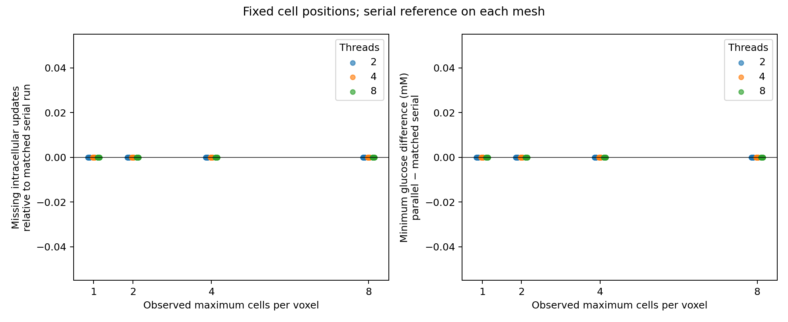

# Mesh occupancy, final

240 runs: 8 fixed cells in 16/8/4/2 µm voxels (8/4/2/1 cells per voxel), 1/2/4/8 threads, 5 seeds, 3 repeats. Validated by `summarize_mesh.py` (240 runs, 180 matched pairs; [mesh_validation.json](mesh_validation.json)). All parallel runs equal their serial run; only the 2 µm mesh is flagged (−1.19×10⁻⁶ mM serial undershoot).

Part of the [final runs of 2026-11-02](../../final-20261102/README.md) (PhysiCelldFBA PR commit `c59daa81`), where the results are interpreted.

- Figures: [mesh16/diagnostics.png](plots/mesh16/diagnostics.png) ([PDF](plots/mesh16/diagnostics.pdf)), [mesh16/glucose_by_seed.png](plots/mesh16/glucose_by_seed.png) ([PDF](plots/mesh16/glucose_by_seed.pdf)), [mesh2/diagnostics.png](plots/mesh2/diagnostics.png) ([PDF](plots/mesh2/diagnostics.pdf)), [mesh2/glucose_by_seed.png](plots/mesh2/glucose_by_seed.png) ([PDF](plots/mesh2/glucose_by_seed.pdf)), [mesh4/diagnostics.png](plots/mesh4/diagnostics.png) ([PDF](plots/mesh4/diagnostics.pdf)), [mesh4/glucose_by_seed.png](plots/mesh4/glucose_by_seed.png) ([PDF](plots/mesh4/glucose_by_seed.pdf)), [mesh8/diagnostics.png](plots/mesh8/diagnostics.png) ([PDF](plots/mesh8/diagnostics.pdf)), [mesh8/glucose_by_seed.png](plots/mesh8/glucose_by_seed.png) ([PDF](plots/mesh8/glucose_by_seed.pdf)), [mesh_comparison.png](plots/mesh_comparison.png) ([PDF](plots/mesh_comparison.pdf))
- Tables: [coverage.csv](tables/coverage.csv), [mesh_run_diagnostics.csv](tables/mesh_run_diagnostics.csv), [mesh_thread_summary.csv](tables/mesh_thread_summary.csv), [paired_serial_parallel.csv](tables/paired_serial_parallel.csv), [runs.csv](tables/runs.csv), [same_seed_repeats.csv](tables/same_seed_repeats.csv), [substrate_trajectories.csv](tables/substrate_trajectories.csv)
- Compact per-run evidence in [data/](data/); `analysis.json` records the analysis-script and evidence hashes.
