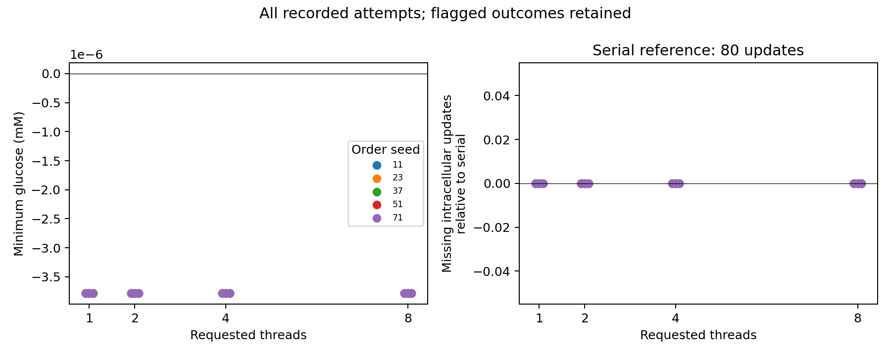

# Eight-cell shared-voxel results after the PR #19 race fixes

Repeat of the [60-run coincident-cell campaign](../voxel-20261026/README.md) with the
unchanged protocol on source `23f456b0`, which includes PR #19. All 60 runs completed
with the requested thread counts and 80/80 intracellular updates. Every parallel run
is bitwise-identical to its matched serial run. The only flag is `negative_concentration`
(−3.78×10⁻⁶ mM in every run, serial included), a deterministic growth-related
undershoot that is explained in the comparison report.

Analysis, figures and interpretation:
[before/after comparison](../before-after-20261027/README.md). This directory holds
the `analyze.py` export: [plots](plots/), [tables](tables/), compact raw evidence in
[data/](data/), and `campaign.json`, `protocol.json`, `build.json`, `analysis.json`.
Simulation job 48112700; export job 48113002.

## Figures

- [Diagnostics](plots/diagnostics.png) ([PDF](plots/diagnostics.pdf)): minimum glucose and missing
  intracellular updates relative to the matched serial run, per order seed and thread count.
- [Glucose by seed](plots/glucose_by_seed.png) ([PDF](plots/glucose_by_seed.pdf)): minimum-glucose
  trajectories per order seed; curves for every thread count overlap.
- The pre-fix equivalents are in the [original report](../voxel-20261026/README.md); the side-by-side
  view is in the [before/after comparison](../before-after-20261027/plots/before_after.png).
