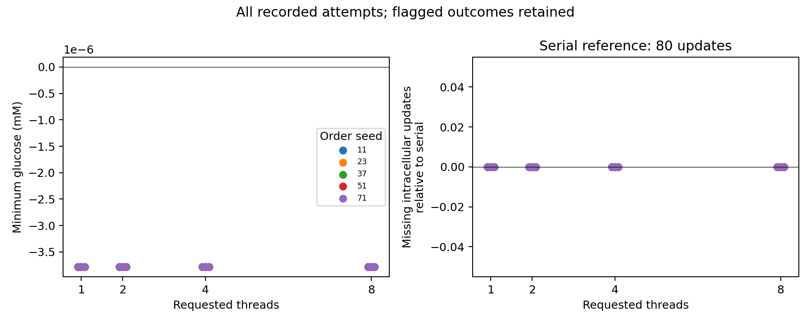

# Shared voxel, final

60 runs: 8 E. coli core cells in one 1.6 µm voxel, 1/2/4/8 threads, 5 order seeds, 3 repeats, 0.1 min. All parallel runs are bitwise-identical to their matched serial run; the only flag is the known −3.78×10⁻⁶ mM serial undershoot. Job list in the [final report's workflow folder](../../final-20261102/workflow/).

Part of the [final runs of 2026-11-02](../../final-20261102/README.md) (PhysiCelldFBA PR commit `c59daa81`), where the results are interpreted.

- Figures: [diagnostics.png](plots/diagnostics.png) ([PDF](plots/diagnostics.pdf)), [glucose_by_seed.png](plots/glucose_by_seed.png) ([PDF](plots/glucose_by_seed.pdf))
- Tables: [coverage.csv](tables/coverage.csv), [paired_serial_parallel.csv](tables/paired_serial_parallel.csv), [runs.csv](tables/runs.csv), [substrate_trajectories.csv](tables/substrate_trajectories.csv)
- Compact per-run evidence in [data/](data/); `analysis.json` records the analysis-script and evidence hashes.
